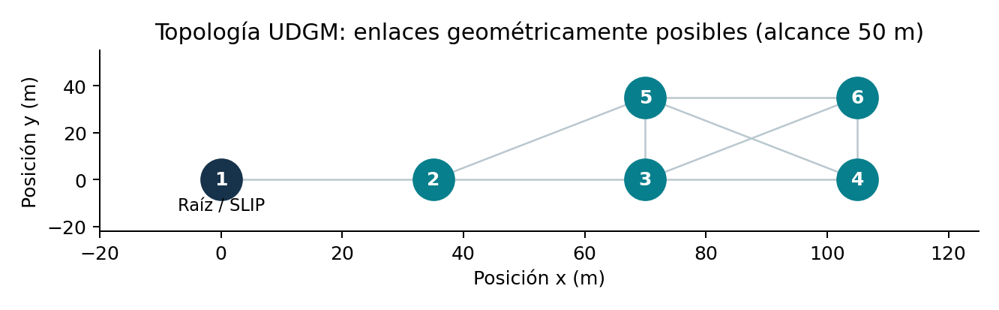
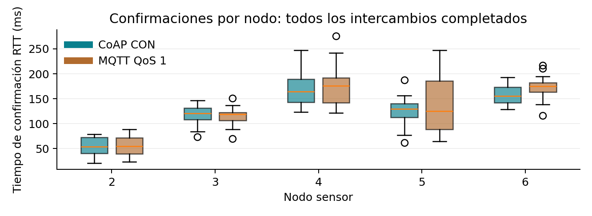

# Tarea 4: Mensajería CoAP y MQTT


TEL329 - Redes de Sensores | 12 de noviembre de 2026.


Integrantes: Agustín López, Sebastián Romero y Óscar Carrasco.


En esta tarea comparamos el envío de lecturas de temperatura mediante CoAP y MQTT en una red de sensores simulada. Para ello usamos Contiki-NG y Cooja, medimos los tiempos de confirmación de ambos protocolos y luego conectamos un sensor a Azure IoT Hub. En la última parte comprobamos el recorrido completo de diez lecturas, desde el mote hasta el consumidor en la nube. Las lecturas se generan por software; representan datos de prueba, no mediciones ambientales.


## 1. Escenario experimental


Preparamos dos escenarios con la misma distribución de nodos: una raíz RPL Lite y cinco sensores, identificados del 2 al 6. Ambos trabajan con IPv6/6LoWPAN y CSMA. Usamos Contiki-NG release/v5.1 y Cooja con Java 21, dentro de un entorno Linux AArch64 en Docker. La raíz conecta la red con Linux mediante SLIP y tunslip6. En ese anfitrión, con dirección fd00::1, ejecutamos el servidor CoAP o el broker Mosquitto. Así, cada red tiene seis motes y un servicio externo que recibe sus mensajes.





Cada comparación dura 240 s y usa la semilla 1, con velocidad de simulación 1:1. Configuramos UDGM con 50 m de alcance y 100 m de interferencia. Aunque la probabilidad de éxito del modelo está fijada en 1, todavía pueden existir colisiones, espera por el canal y retransmisiones. Dejamos pasar 60 s antes de iniciar los envíos y los desfasamos según el ID del nodo. La expresión 15 + random_rand() % 25 produce temperaturas enteras entre 15 y 39 °C.


## 2. Actividad 1: RPL Lite y CoAP


Para la primera actividad adaptamos coap-sensor.c, de manera que cada cliente enviara su temperatura al recurso /temperature del servidor en fd00::1. Elegimos mensajes POST confirmables (CON) para que cada lectura tuviera una respuesta que pudiéramos medir. El JSON incluye la temperatura, el nodo que la generó y su secuencia. En este caso la notificación parte del sensor mediante POST; no usamos la extensión Observe.


```text
coap_init_message(request, COAP_TYPE_CON, COAP_POST, 0);
coap_set_header_uri_path(request, "temperature");
coap_set_header_content_format(request, APPLICATION_JSON);
COAP_BLOCKING_REQUEST(&endpoint, request, response);
```


Al recibir una lectura válida, el servidor aiocoap devuelve 2.04 Changed dentro del ACK, conservando el Message ID y el token. En la salida de Contiki esta respuesta aparece como code=68. Pudimos comprobarla tanto en los paquetes capturados como en el registro del cliente. Después de recibirla, el sensor espera 10 s antes del siguiente envío. Por eso, el tiempo entre lecturas incluye esos 10 s más el RTT de la anterior.


```text
Sensor 2, registro real:
COAP_SEND node=2 seq=1 payload={"node":2,"seq":1,"temp":20}
COAP_ACK node=2 seq=1 code=68 rtt_ticks=54

Servidor: {"event":"COAP_RECEIVED","node":2,"seq":1,"temp":20}
```


En total recibimos 90 notificaciones y sus 90 confirmaciones. Cada sensor completó 18 intercambios. El RTT medio fue 124.31 ms; mediana 131.90 ms y percentil 95 192.08 ms. En esta ejecución todos los envíos tuvieron respuesta.


El ejemplo anterior corresponde a la primera lectura del nodo 2. Para revisar los demás intercambios dejamos los registros de Cooja y del servidor en results/coap/, junto con los PCAP y responses.csv. Cooja terminó la ejecución con TEST OK. El programa, el Makefile y la configuración están en firmware/.


## 3. Actividad 2: RPL Lite y MQTT


En la segunda actividad usamos mqtt-sensor.c y el motor MQTT de Contiki-NG. Los cinco sensores se conectan a Mosquitto 2.0.11 en [fd00::1]:1883 y comparten un solo tema: tel329/temperature. Configuramos MQTT 3.1.1 con QoS 1 para contar con una confirmación por publicación. Cada nodo usa su propio identificador de cliente, tel329-node-ID, y mantiene abierta la conexión TCP. La opción retain queda desactivada.


```text
mqtt_register(&conn, &sensor_process, client_id, event, 128);
mqtt_connect(&conn, "fd00::1", 1883, 60, MQTT_CLEAN_SESSION_ON);
mqtt_publish(&conn, &mid, topic, (uint8_t *)payload,
             strlen(payload), MQTT_QOS_LEVEL_1, MQTT_RETAIN_OFF);
```


Cuando Mosquitto recibe un PUBLISH, responde con el PUBACK correspondiente. Además, dejamos mosquitto_sub suscrito al mismo tema para comprobar que las lecturas llegaban al otro extremo de la aplicación. Esta distinción importa al interpretar la medición: el PUBACK confirma que el broker recibió el mensaje; la entrega al suscriptor se comprueba por separado en su registro.


```text
MQTT_CONNECTED node=2
MQTT_SEND node=2 seq=1 mid=3 payload={"node":2,"seq":1,"temp":29}
MQTT_ACK node=2 seq=1 mid=3 rtt_ticks=53
Suscriptor:
tel329/temperature {"node":2,"seq":1,"temp":29}
```


Al finalizar registramos 85 publicaciones y 85 PUBACK correlacionados. El RTT medio fue 130.41 ms; mediana 127.34 ms y p95 215.96 ms. La primera publicación se realiza en una iteración posterior a la conexión, lo que explica que haya 17 lecturas por sensor, frente a las 18 de CoAP. Para calcular el RTT de publicación dejamos fuera el establecimiento TCP/CONNECT, aunque también quedó capturado.


La salida del suscriptor coincide con el mensaje enviado por el nodo 2. En results/mqtt/ se incluyen los registros de Cooja, Mosquitto y el suscriptor, además de las capturas y la tabla completa de respuestas. Para esta comparación local usamos un broker anónimo dentro del contenedor y MQTT sin TLS. La conexión con Azure, presentada más adelante, sí utiliza cifrado.


## 4. Actividad 3: captura y tiempos de respuesta


Para relacionar los mensajes con sus respuestas registramos el tráfico en tres lugares: la radio IEEE 802.15.4 de Cooja, la capa IPv6 de cada sensor y el túnel hacia Linux, donde usamos tcpdump. El script analyze.py convierte los registros a PCAP y los decodifica con tshark. Las capturas de radio y sensores usan el tiempo de simulación, mientras que la del túnel usa el reloj del contenedor.


Calculamos el RTT como la diferencia entre el primer envío y la recepción de su confirmación, siempre desde el mismo sensor. En CoAP emparejamos CON y ACK por Message ID y token; en MQTT usamos el flujo TCP y el identificador de PUBLISH/PUBACK. Excluimos los paquetes RPL que todavía iban en tránsito (Segments Left mayor que cero). También contrastamos los tiempos de los PCAP con los del programa: coincidieron con una tolerancia de 2 ms, usando CLOCK_SECOND=1000. El contador de solicitudes decodificadas se conserva aparte y no representa todas las retransmisiones TCP.


| Protocolo | n | Media ms | Mediana ms | p95 ms | Mín-max ms |
| --- | --- | --- | --- | --- | --- |
| CoAP CON | 90 | 124.31 | 131.90 | 192.08 | 21.02-247.53 |
| MQTT QoS 1 | 85 | 130.41 | 127.34 | 215.96 | 23.30-275.38 |


| Nodo | n CoAP | Media CoAP ms | n MQTT | Media MQTT ms |
| --- | --- | --- | --- | --- |
| 2 | 18 | 53.40 | 17 | 55.30 |
| 3 | 18 | 116.79 | 17 | 115.16 |
| 4 | 18 | 169.39 | 17 | 176.18 |
| 5 | 18 | 124.56 | 17 | 132.97 |
| 6 | 18 | 157.39 | 17 | 172.46 |





## 5. Comparación de las mediciones


Para mostrar algunos intercambios concretos elegimos las secuencias 1 y 10 de cada nodo en ambos protocolos. Aplicamos la misma regla a los cinco sensores para evitar escoger solo los casos más favorables. Los promedios y percentiles de la página anterior se calcularon con la muestra completa. Los CSV permiten ubicar cada solicitud y respuesta en Wireshark mediante sus números de trama e identificadores.


| Nodo | Secuencia | CoAP RTT ms | MQTT RTT ms |
| --- | --- | --- | --- |
| 2 | 1 | 54.02 | 53.30 |
| 2 | 10 | 40.02 | 63.30 |
| 3 | 1 | 113.27 | 150.56 |
| 3 | 10 | 131.27 | 116.56 |
| 4 | 1 | 142.53 | 140.63 |
| 4 | 10 | 163.53 | 141.66 |
| 5 | 1 | 156.27 | 87.56 |
| 5 | 10 | 121.27 | 64.56 |
| 6 | 1 | 176.53 | 187.82 |
| 6 | 10 | 129.53 | 194.82 |


Al comparar los promedios, MQTT tardó 6.11 ms más que CoAP en confirmar los mensajes. Sin embargo, esa diferencia no aparece de la misma manera en todos los nodos. Cada salto agrega transmisiones y oportunidades de esperar por el canal. Además, MQTT incorpora el funcionamiento de TCP, mientras que CoAP trabaja sobre UDP. Como también medimos el paso por el túnel y el procesamiento del servicio, no podemos atribuir la diferencia únicamente a las cabeceras de los protocolos.


La distancia en saltos ayuda a entender las diferencias entre sensores. El nodo 2 llega a la raíz en un salto; los nodos 3 y 5 necesitan dos, y los nodos 4 y 6, tres. Además, RPL eligió un padre distinto para el nodo 6 en cada escenario. Aunque conservamos las posiciones, las rutas y la competencia por el canal no fueron exactamente iguales.


También hay diferencias en lo que confirma cada protocolo. La respuesta CoAP 2.04 indica que el servidor procesó el POST, mientras que PUBACK confirma la aceptación por el broker. Estamos comparando tiempos de confirmación de telemetría, con alcances distintos. A esto se suma que CoAP espera 10 s después de cada respuesta y MQTT revisa su estado cada 10 s. Los protocolos también generan tráfico de control y consumen números aleatorios de manera diferente.


Con estas condiciones, la diferencia observada es pequeña y depende del escenario. Una sola ejecución no permite afirmar que uno de los protocolos siempre sea más rápido. Para sostener una conclusión más amplia habría que repetir con varias semillas, cargas y condiciones de pérdida. También sería necesario evaluar el efecto del cifrado y del hardware físico. En esta ejecución todos los mensajes enviados tuvieron confirmación; los archivos unmatched.json registran cero intercambios pendientes.


## 6. Actividad 4: integración real con Azure


Para llevar las lecturas a la nube usamos el Hub tel329-t4-alopez-20261112, en Brazil South, y registramos el dispositivo contiki-ng-01 con autenticación simétrica. Elegimos el nivel F1 Free: el portal indicaba USD 0 al mes y una cuota de 8.000 mensajes diarios, suficiente para las diez lecturas de esta prueba.


El recorrido parte de un mote que ejecuta http-sensor.c y se conecta a Linux a través del border router RPL Lite. El middleware, escrito para Node.js 22, consulta GET / en la dirección IPv6 del sensor, lee temperatura y humedad y las envía a Azure por MQTT/TLS. Finalmente, un programa independiente usa EventHubConsumerClient para recibirlas desde el endpoint integrado, mediante AMQP/TLS.


4.a - Middleware. Obtuvimos diez envíos confirmados, identificados en el registro con event=SENT y mode=azure. Antes de enviarlos, el programa cambia los nombres temp/hum por temperature/humidity y agrega el dispositivo, la fecha de lectura y temperatureAlert. Esta alerta se activa sobre 30 °C. El nodo y la secuencia se conservan para seguir cada lectura a través de todo el recorrido. Las claves se guardan en el archivo local .env, que se excluye de la entrega.


```text
4.b - Respuesta real del mote:
{"node":2,"seq":1,"temp":31,"hum":85}

4.a - Envío real a Azure:
event=SENT, mode=azure, deviceId=contiki-ng-01
node=2, seq=1, temperature=31
humidity=85, temperatureAlert=true

4.c - Consumidor:
event=AZURE_RECEIVED, partition=0
```


4.b - Sensor. El mote respondió diez consultas con datos JSON sobre IPv6/TCP. La primera lectura, mostrada arriba, fue de 31 °C y 85 % de humedad. El firmware genera temperaturas entre 15 y 39 °C y humedades entre 80 y 89 %. Cada respuesta queda registrada como HTTP_SENSOR en Cooja, lo que permite contrastar el dato original con el enviado a la nube.


4.c - Suscriptor. Recibimos diez eventos únicos desde Azure, registrados como AZURE_RECEIVED. Al compararlos con el mote y el middleware, coincidieron el nodo, la secuencia, la temperatura, la humedad y la alerta. La propiedad iothub-connection-device-id también confirmó que Azure los recibió del dispositivo contiki-ng-01. El script check_azure.py realiza estas comprobaciones para toda la muestra.


Los registros del mote, del middleware y del consumidor están en results/azure/, junto con readings.csv y el resultado de la verificación. La simulación terminó normalmente con TEST OK. Como comprobación adicional, el middleware superó cuatro pruebas para lecturas válidas, datos fuera de rango, errores HTTP y sensores que no responden.


## 7. Evidencia de Azure y lecturas recibidas


| Propiedad del recurso | Valor verificado |
| --- | --- |
| IoT Hub | tel329-t4-alopez-20261112 |
| Estado | Active |
| Nivel | F1 Free (USD 0/mes) |
| Región | Brazil South |
| Dispositivo | contiki-ng-01 |
| Lecturas enviadas / recibidas | 10 / 10 |


La tabla resume la configuración que comprobamos en el portal de Azure. Dejamos fuera de la edición pública la captura de esa pantalla, porque contiene datos de la cuenta. Para respaldar los resultados incluimos los registros originales del sensor, del middleware y del consumidor, además de las diez lecturas recibidas que se muestran a continuación.


| Secuencia | Temperatura °C | Humedad % | Alerta >30 °C |
| --- | --- | --- | --- |
| 1 | 31 | 85 | true |
| 2 | 33 | 83 | true |
| 3 | 23 | 87 | false |
| 4 | 39 | 82 | true |
| 5 | 19 | 88 | false |
| 6 | 27 | 80 | false |
| 7 | 15 | 81 | false |
| 8 | 29 | 82 | false |
| 9 | 20 | 82 | false |
| 10 | 18 | 89 | false |


Iniciamos el suscriptor antes de enviar la primera lectura para que pudiera recibir toda la muestra desde su arranque. El consumidor usa la directiva service. Para registrar la identidad del sensor recurrimos al SDK oficial azure-iothub, ya que la vista Dispositivos del portal devolvía un error. La conexión posterior del dispositivo y la recepción de los mensajes permitieron comprobar que el registro había quedado operativo.


Antes de conectar con Azure también probamos el recorrido local, guardando diez lecturas en un archivo y leyéndolas con otro programa. Ese control ayudó a verificar la transformación de los datos. Sus registros se conservan en results/http/; la prueba de conexión con la nube está en results/azure/.


## 8. Reproducción, publicación y referencias


Organizamos la entrega para que se puedan revisar los resultados y repetir las pruebas. El ZIP reúne el firmware, las simulaciones, los scripts, los PCAP, los registros y el informe en PDF y Markdown. setup.sh descarga las versiones fijadas de Contiki-NG y Cooja, y run.sh ejecuta los escenarios por separado. Para Azure, los procesos de Node.js comparten la red del contenedor que contiene el túnel IPv6.


```text
bash tarea4/scripts/setup.sh
bash tarea4/scripts/run.sh coap mqtt http
docker run --rm -v "$PWD:/work" tel329-tarea4:1 \
  python3 /work/tarea4/scripts/analyze.py
python3 tarea4/scripts/check_cloud.py
# Con .env de Azure configurado:
bash tarea4/scripts/run_azure.sh
python3 tarea4/scripts/check_azure.py
node --test tarea4/cloud/test.cjs
python3 tarea4/scripts/build_report.py
```


Las instrucciones para repetir la integración con Azure están en cloud/LEEME_AZURE.md. Las credenciales se configuran localmente y el Hub utilizado permanece en el nivel gratuito F1. Publicamos el código, el informe y las evidencias en https://github.com/aguslopezleg/tel329-tarea4-coap-mqtt, de acuerdo con lo solicitado en el enunciado.


En conjunto, las pruebas permitieron observar dos formas distintas de enviar telemetría sobre RPL Lite. Ambos protocolos entregaron todas las lecturas generadas; CoAP tuvo una media de confirmación ligeramente menor, aunque esa diferencia no basta para generalizar. La integración con Azure completó el recorrido desde el mote hasta el consumidor y conservó los valores de las diez lecturas. Las capturas y los registros incluidos permiten revisar esas conclusiones a partir de los datos.


- [Repositorio público de esta entrega](https://github.com/aguslopezleg/tel329-tarea4-coap-mqtt)

- [Enunciado TEL329 Tarea 4, versión 1.0, 2026](references/TEL329-Tarea4-2026-v1.0.html)

- [Contiki-NG release/v5.1 y fuentes de CoAP/MQTT](https://github.com/contiki-ng/contiki-ng/tree/2b87baf3ebdde3c8e37ca791d2bc84bfd76c49a4)

- [Contiki-NG: Cooja, simulating a border router](https://docs.contiki-ng.org/en/master/doc/tutorials/Cooja-simulating-a-border-router.html)

- [RFC 7252: CoAP, secciones 4 y 5](https://www.rfc-editor.org/rfc/rfc7252)

- [OASIS MQTT 3.1.1, secciones 3.3 y 4.3.2](https://docs.oasis-open.org/mqtt/mqtt/v3.1.1/os/mqtt-v3.1.1-os.html)

- [Microsoft Learn: endpoints de IoT Hub](https://learn.microsoft.com/en-us/azure/iot-hub/iot-hub-devguide-endpoints)

- [Microsoft Learn: SDK Event Hubs JavaScript](https://learn.microsoft.com/en-us/javascript/api/overview/azure/event-hubs-readme?view=azure-node-latest)
